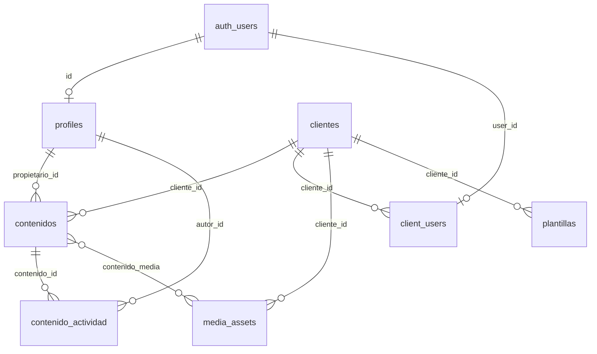

# Propuesta de esquema — Supabase

Estado: **propuesta**, nada de esto está implementado ni conectado. El frontend sigue corriendo sobre datos en memoria (`src/data/*.ts` + Zustand). Este documento traduce ese mismo modelo a tablas de Postgres/Supabase, listo para cuando se conecte un backend real.

## Resumen de decisiones

- **Un solo workspace (la agencia) por ahora.** El modelo asume una sola agencia usando Publifya, con varios `clientes`. Si más adelante Publifya se vende a varias agencias, se agrega una tabla `workspaces` por encima de `clientes` y `profiles` — está marcado abajo como extensión, no hace falta para el MVP.
- **Dos tipos de usuario, dos formas de entrar:** el equipo de la agencia (`profiles`, autenticados normal) y los clientes finales (`client_users`, acceso restringido a un solo `cliente` vía RLS) — esto reemplaza el link público sin autenticación que tiene hoy `/portal/[clienteId]`.
- **Estados y transiciones del contenido se validan con funciones RPC**, no con `UPDATE` directo desde el portal del cliente, para que un cliente no pueda, por ejemplo, marcar su propio contenido como "Publicado".
- **Enums de Postgres** para `estado`, `tipo` y `red`, igual que los `type` de TypeScript actuales — así el feature set no se abre más de lo pensado por accidente.

## Diagrama



## Tablas

### `profiles` — equipo interno de la agencia

Extiende `auth.users` (1:1). Reemplaza el array plano `EQUIPO` del frontend.

```sql
create table profiles (
  id uuid primary key references auth.users (id) on delete cascade,
  nombre text not null,
  rol text not null default 'miembro' check (rol in ('admin', 'miembro')),
  avatar_url text,
  created_at timestamptz not null default now()
);
```

### `clientes` — las cuentas que administra la agencia

```sql
create table clientes (
  id uuid primary key default gen_random_uuid(),
  slug text not null unique,              -- "cafe-luna" — lo que hoy se usa como id y como /portal/[clienteId]
  nombre text not null,
  sector text,
  color text not null,                     -- hex, para los badges de cliente en la UI
  iniciales text not null,
  created_at timestamptz not null default now()
);
```

### `client_users` — acceso del cliente final al portal

Un usuario de `auth.users` por cliente (o varios, si el cliente tiene más de una persona con acceso). Esto es lo que falta hoy: ahora mismo `/portal/[clienteId]` es público para quien tenga el link.

```sql
create table client_users (
  user_id uuid primary key references auth.users (id) on delete cascade,
  cliente_id uuid not null references clientes (id) on delete cascade,
  nombre text,
  created_at timestamptz not null default now()
);

create index on client_users (cliente_id);
```

### Enums — espejo de los `type` de TypeScript

```sql
create type estado_contenido as enum ('borrador', 'en_revision', 'programado', 'publicado');
create type tipo_contenido as enum ('publicacion', 'historia', 'reel', 'carrusel', 'video', 'articulo', 'newsletter', 'infografia');
create type red_social as enum ('instagram', 'facebook', 'tiktok', 'x', 'linkedin', 'youtube', 'blog', 'email', 'web');
```

### `contenidos` — el contenido editorial

```sql
create table contenidos (
  id uuid primary key default gen_random_uuid(),
  cliente_id uuid not null references clientes (id) on delete cascade,
  titulo text not null,
  descripcion text not null default '',
  estado estado_contenido not null default 'borrador',
  tipo tipo_contenido not null,
  red red_social not null,
  propietario_id uuid references profiles (id),
  fecha_publicacion date,
  etiquetas text[] not null default '{}',   -- array simple, igual que hoy; ver "Extensiones" para normalizarlo
  comentario_cliente text,                  -- lo que el cliente escribe al pedir cambios desde el portal
  created_at timestamptz not null default now(),
  updated_at timestamptz not null default now()
);

create index on contenidos (cliente_id);
create index on contenidos (estado);

create trigger set_updated_at
  before update on contenidos
  for each row execute function moddatetime(updated_at); -- extensión "moddatetime" de Supabase
```

### `contenido_actividad` — historial (reemplaza el bloque "Actividad" hardcodeado del panel)

```sql
create table contenido_actividad (
  id uuid primary key default gen_random_uuid(),
  contenido_id uuid not null references contenidos (id) on delete cascade,
  autor_id uuid references profiles (id),     -- null si la acción vino del cliente
  tipo text not null check (tipo in ('creado', 'actualizado', 'aprobado', 'cambios_solicitados', 'eliminado')),
  detalle text,
  created_at timestamptz not null default now()
);

create index on contenido_actividad (contenido_id, created_at desc);
```

### Funciones RPC para las acciones del portal

El cliente final nunca hace `UPDATE contenidos ... ` directo. Llama estas funciones, que validan la transición y registran la actividad:

```sql
create or replace function approve_content(p_contenido_id uuid)
returns void language plpgsql security definer as $$
begin
  update contenidos
    set estado = 'programado', comentario_cliente = null
    where id = p_contenido_id and estado = 'en_revision'
      and cliente_id = (select cliente_id from client_users where user_id = auth.uid());

  insert into contenido_actividad (contenido_id, tipo)
    values (p_contenido_id, 'aprobado');
end;
$$;

create or replace function request_content_changes(p_contenido_id uuid, p_comentario text)
returns void language plpgsql security definer as $$
begin
  update contenidos
    set estado = 'borrador', comentario_cliente = p_comentario
    where id = p_contenido_id and estado = 'en_revision'
      and cliente_id = (select cliente_id from client_users where user_id = auth.uid());

  insert into contenido_actividad (contenido_id, tipo, detalle)
    values (p_contenido_id, 'cambios_solicitados', p_comentario);
end;
$$;
```

## Row Level Security

RLS habilitado en todas las tablas. Boceto de políticas (ajustar nombres/roles si se agrega más granularidad):

```sql
alter table clientes enable row level security;
alter table contenidos enable row level security;
alter table contenido_actividad enable row level security;
alter table client_users enable row level security;

-- Equipo interno: ve todo (se puede restringir por cliente más adelante, ver Extensiones)
create policy "equipo ve todos los clientes"
  on clientes for select
  using (exists (select 1 from profiles where id = auth.uid()));

create policy "equipo gestiona contenidos"
  on contenidos for all
  using (exists (select 1 from profiles where id = auth.uid()));

-- Cliente final: solo su propia fila en `clientes`, y solo sus propios contenidos (solo lectura)
create policy "cliente ve su propia cuenta"
  on clientes for select
  using (id = (select cliente_id from client_users where user_id = auth.uid()));

create policy "cliente ve su propio contenido"
  on contenidos for select
  using (cliente_id = (select cliente_id from client_users where user_id = auth.uid()));
```

El cliente final **no** tiene policy de `insert`/`update`/`delete` sobre `contenidos` — sus únicas escrituras pasan por `approve_content` / `request_content_changes`, que corren con `security definer` y validan la transición ellas mismas.

## Extensiones (fuera del MVP, para cuando se necesiten)

- **`media_assets`** + bucket de Supabase Storage (`media`, carpeta por `cliente_id`) para el módulo "Biblioteca multimedia", con una tabla puente `contenido_media (contenido_id, media_id)` para adjuntos.
- **`plantillas`** (`id`, `cliente_id` nullable — null = plantilla global, `tipo`, `cuerpo jsonb`, `created_by`) para el módulo "Plantillas".
- **`team_clientes`** (`profile_id`, `cliente_id`) si se necesita que no todo el equipo vea todos los clientes — hoy el panel interno no distingue permisos por cliente, así que no está en el MVP.
- **`contenido_tags`** normalizada (`tags(id, nombre)` + `contenido_tags(contenido_id, tag_id)`) en vez del array `etiquetas text[]`, si se necesita autocompletar o filtrar etiquetas entre clientes de forma eficiente.
- **`workspaces`** por encima de `clientes`/`profiles` si Publifya pasa a atender a más de una agencia.
